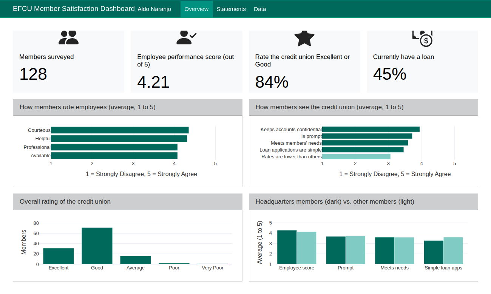

## What you'll find here

This page is the entry point to my Quarto dashboard. It's built for my MSDM Culminating Experience Project (CEP), where my part of the work focuses on where Cal Poly Pomona's Collins College of Hospitality Management loses prospective students between applying and enrolling, and which factors most influence the decision to enroll. Part of that work is a survey of current students.

The client data isn't available yet, so this version uses **Case 31**, a credit union member survey with 128 respondents. It's the same kind of data I'll be reporting on for the CEP: rating scales, yes or no questions, and group comparisons. That makes it a good stand in for building the layout and charts now.

[Open the full dashboard →](dashboard.qmd){.big-button}

## Quick preview

[{fig-alt="Screenshot of the dashboard overview page with four headline numbers and four charts" style="border: 1px solid #dfe5e4; border-radius: 10px; box-shadow: 0 6px 18px rgba(0,0,0,.10);"}](dashboard.qmd)

## What the data shows

::: {.grid}
::: {.g-col-12 .g-col-md-6 .hover-card}
#### Employees are the strength
Members rate staff highly. Courtesy (4.35 out of 5) and helpfulness (4.31) lead, with professionalism and availability close behind at 4.08.
:::
::: {.g-col-12 .g-col-md-6 .hover-card}
#### Overall satisfaction is strong
84% of members who gave a rating called the credit union Excellent or Good, and only 3 members rated it Poor or Very Poor.
:::
::: {.g-col-12 .g-col-md-6 .hover-card}
#### Rates are the biggest opportunity
"Rates are lower than at other institutions" scored 3.06, the lowest of any statement. That points to a messaging or pricing gap worth digging into.
:::
::: {.g-col-12 .g-col-md-6 .hover-card}
#### Loan applications vary by location
Headquarters members gave employees a higher score (4.28 vs. 4.14) but found loan applications less simple (3.28 vs. 3.61) than members at other locations.
:::
:::

## How the dashboard is organized

| Page | What it shows |
|:--|:--|
| **Overview** | Four headline numbers, employee ratings, credit union statements, the overall rating, and a headquarters comparison |
| **Statements** | Whether statements come often enough, how accurate they are, and whether members understand them |
| **Data** | A table of the responses used, plus notes on scales and what was left out |

## How it was built

The dashboard is a single Quarto file using `format: dashboard`. Python reads the SPSS file with `pyreadstat`, `pandas` calculates the averages and percentages, and `plotly` draws the interactive charts. Value boxes, rows, and pages are all set with Quarto's dashboard layout syntax:

```{.yaml}
format:
  dashboard:
    orientation: rows
```

```{.markdown}
# Overview          <- a page (tab) of the dashboard
## Row {height=26%} <- a row of cards on that page
```

When the CEP data arrives, the same structure can be pointed at the Collins College admissions and survey data with only the column names changing.
