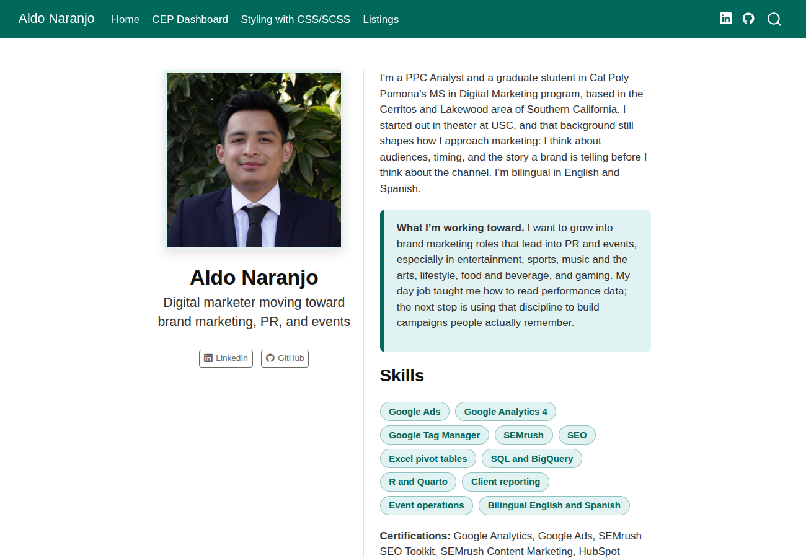

# Links {.unnumbered}

::: {.callout-note appearance="simple" icon=false}
## Where to find the work
- **Live website (GitHub Pages):** [naran115.github.io/m10-portfolio-website](https://naran115.github.io/m10-portfolio-website/)
- **GitHub repository (all source files):** [github.com/naran115/m10-portfolio-website](https://github.com/naran115/m10-portfolio-website)
:::

# The Website at a Glance

> *Build a website that showcases your knowledge and publish it to GitHub Pages, using a home page, a Quarto dashboard, a page on CSS/SCSS, and a page on Listings.*

The site is a four page Quarto website published to GitHub Pages from the `docs` folder. Every page shares one navigation bar, one footer, and one custom SCSS theme in a dark teal palette that matches my resume.

{fig-alt="Screenshot of the home page with headshot, bio, and skills" width="100%"}

| Tab | File | Purpose |
|:--|:--|:--|
| **Home** | `index.qmd` | Photo, bio, career aspirations, skills, education, and experience |
| **CEP Dashboard** | `dashboard-portal.qmd` and `dashboard.qmd` | Portal page plus an interactive Quarto dashboard |
| **Styling with CSS/SCSS** | `css-scss.qmd` and `custom.scss` | How the site's look was built, using its own code |
| **Listings** | `listings.qmd` and `projects/` | A live Listing of five project pages, with an explanation of how it works |

# Home Page

> *Create a home page with your short bio and photo, including your career aspirations, skills, and education.*

The home page uses Quarto's `about` page template (`trestles`), which places the photo and social links on the left and the bio on the right. It covers:

- **Bio:** PPC Analyst at Unbiazed and MSDM student at Cal Poly Pomona, with a theater background from USC.
- **Career aspirations:** brand marketing roles that lead into PR and events, in entertainment, sports, music, gaming, and similar industries.
- **Skills:** shown as styled tags (a custom `.skill-pill` class), plus certifications.
- **Education and experience:** education in side by side cards, then four roles.

# CEP Dashboard

> *Add a page that serves as a portal to a Quarto dashboard showcasing your CEP. If you don't have data yet, you may use Case 31 data.*

My CEP client data from the Collins College of Hospitality Management has not arrived, so the dashboard uses the **Case 31** credit union member survey (128 respondents). The portal page explains the CEP connection, summarizes four findings, and links to the full dashboard.

{fig-alt="Screenshot of the dashboard with value boxes and four charts" width="100%"}

The dashboard (`format: dashboard`) has three pages:

1. **Overview:** four value boxes and four interactive charts (employee ratings, credit union statements, overall rating, and headquarters vs. other members).
2. **Statements:** frequency, accuracy, and clarity of account statements.
3. **Data:** the responses used, plus notes on scales and what was left out and why.

# Styling with CSS/SCSS

> *Add a page dedicated to CSS/SCSS that shows your understanding of how to style a Quarto website.*

The page explains the difference between built in themes, CSS, and SCSS, then walks through this site's real `custom.scss` file:

- **`scss:defaults`:** brand color variables that recolor the whole Bootstrap theme through `$primary`, `$body-color`, and `$headings-color`.
- **`scss:rules`:** reusable classes (`.skill-pill`, `.teal-callout`, `.hover-card`, `.big-button`) with SCSS nesting for hover effects.
- **A tabset** showing the markdown I type next to the styled result.

# Listings

> *Add a page about Listings in Quarto and how you can use them for your portfolio.*

The Listings page is itself a working example. It pulls five project pages from the `projects/` folder into a **grid** Listing with a category filter, then shows the same projects as a **table** Listing. The page explains the YAML in each project file, the `listing:` settings, and the three Listing types (`default`, `grid`, and `table`).

# How the Site Is Configured

All four pages are tied together in `_quarto.yml`:

```{.yaml filename="_quarto.yml (excerpt)"}
project:
  type: website
  output-dir: docs

website:
  title: "Aldo Naranjo"
  navbar:
    left:
      - href: index.qmd
        text: Home
      - href: dashboard-portal.qmd
        text: CEP Dashboard
      - href: css-scss.qmd
        text: Styling with CSS/SCSS
      - href: listings.qmd
        text: Listings

format:
  html:
    theme:
      light: [cosmo, custom.scss]
```

Setting `output-dir: docs` sends the rendered site to the `docs` folder, and GitHub Pages publishes from **main** and **/docs**.
